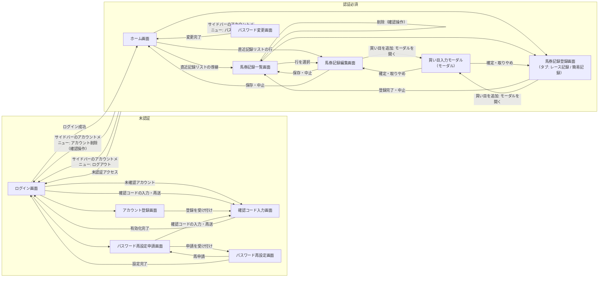

# 画面設計概要: keiba-log

| 項目 | 内容 |
|---|---|
| 機能名 | `keiba-log` |
| 担当 | ui-architect |
| インプット | `requirements/functional-requirements.md`, `requirements/non-functional-requirements.md` |
| 保存先 | `designs/ui-overview.md` |

## 1. 画面一覧

画面の粒度は「ユーザーが1つの目的で遷移する単位」に揃えている。

| 画面名 | 概要 | 対応要件ID |
|---|---|---|
| ログイン画面 | 登録済みの認証情報でログインする。未確認アカウントのときは確認コード入力画面へ進める。確認コード入力画面を直接開く経路を持つ。未認証状態で認証必須画面へアクセスした場合、およびログアウト・アカウント削除の完了後の遷移先を兼ねる。 | `REQ-AUTH-002`, `REQ-AUTH-003`, `REQ-AUTH-004` |
| アカウント登録画面 | 認証情報を入力してアカウント登録を実行し、受け付けたら確認コード入力画面へ進む。確認メールの送信を断定せず、確認コードの入力が残っていることを伝える形にする。登録結果はアカウントの存在・有効化状態を判別できない同一の形で扱う。 | `REQ-AUTH-001` |
| 確認コード入力画面 | 確認メールに記載された確認コードを入力してアカウントを有効化する。対象のメールアドレスは、前の画面から引き継いだとき（アカウント登録の直後、未確認アカウントでのログイン時）は表示のみで示し、入力欄は出さず編集もできない。引き継いでいないとき（直接の経路、再読み込み・URL を直接開いた場合）だけメールアドレスの入力欄を出す。確認コードの再送もこの画面で行う。誤り・期限切れ・有効化済みのいずれも原因を判別できない同一の表示にする。有効化の完了後はログイン画面へ誘導する。入口はアカウント登録の直後、未確認アカウントでのログイン時、およびログイン画面・パスワード再設定申請画面からの直接の経路（「画面遷移の補足」を参照）。 | `REQ-AUTH-006` |
| パスワード再設定申請画面 | メールアドレスを入力してパスワード再設定を申請する。申請結果はメールアドレスの登録状態にかかわらず同一とし、申請後はパスワード再設定画面へそのまま進む。確認コード入力画面を直接開く経路を持つ。 | `REQ-AUTH-007` |
| パスワード再設定画面 | パスワード再設定申請画面から進み、再設定コードと新しいパスワードを同じ画面で入力して、未認証状態で新しいパスワードを設定する。再設定コードが誤り・期限切れのときは、入力し直しとパスワード再設定申請画面での再申請の両方に進める。設定完了後はログイン画面へ誘導する。 | `REQ-AUTH-008` |
| ホーム画面 | ログイン後に最初に表示される画面。収支サマリー領域と直近記録リスト領域を掲載する。馬券記録一覧への導線は直近記録リスト側に置く。グローバルサイドバーとそのアカウントメニュー（アカウント削除の起点）を本画面で最初に扱う。 | `REQ-SUMMARY-001`, `REQ-TICKET-006`, `REQ-AUTH-005` |
| 馬券記録一覧画面 | 自分の馬券記録を日付の新しい順に一覧表示する。各行から編集への遷移と、削除（確認操作を伴う）を開始できる。 | `REQ-TICKET-005`, `REQ-TICKET-004` |
| 馬券記録登録画面 | 馬券記録を新規登録する単一の画面。画面の最上位に記録種別のタブ（レース記録／簡易記録）を置き、タブを切り替えると日付・競馬場などの共通属性を含む入力フォーム全体が切り替わる。共通属性の入力値・入力可能範囲もタブごとに独立する。 | `REQ-TICKET-001`, `REQ-TICKET-002` |
| 馬券記録編集画面 | 登録済みの馬券記録を呼び出して修正・保存する。記録種別によって表示する入力項目が変わる。閲覧専用の詳細画面は設けず、本画面が内容確認の役割も兼ねる。 | `REQ-TICKET-003` |
| 買い目入力モーダル | レース記録の買い目を入力するモーダル。買い方（通常・フォーメーション／ボックス／ながし。業務上の「通常」と「フォーメーション」は表の構成が同じため1つの選択肢にまとめ、成立が1点なら通常の買い目、2点以上ならフォーメーションの買い目の集合として追加する）と券種を選び、番号と役割を軸にしたチェックボックスの表で組合せを指定する。チェックを変えるたびに成立した買い目が追従して表示され、内容を確認してから確定する。馬券記録登録画面・馬券記録編集画面の両方から開く。 | `REQ-TICKET-001`, `REQ-TICKET-003` |
| パスワード変更画面 | ログイン中に現在のパスワードを確認し、新しいパスワードに変更する。グローバルサイドバーのアカウントメニューから遷移する。 | `REQ-AUTH-008` |

### 独立した画面を持たない要件の扱い

| 要件ID | 扱い |
|---|---|
| `REQ-AUTH-003`（ログアウト） | 専用画面は設けない。操作はグローバルサイドバーのアカウントメニュー（共通パーツ）に置き、完了後の遷移先であるログイン画面に紐付ける。 |
| `REQ-AUTH-004`（アクセス制御） | 専用画面は設けない。認証必須画面すべてに共通する仕組みとして扱い、未認証アクセス時の遷移先であるログイン画面に紐付ける。 |
| `REQ-AUTH-005`（アカウント削除） | 専用画面は設けない。操作の起点はグローバルサイドバーのアカウントメニューで、確認ダイアログを経て実行する。起点となるサイドバーとアカウントメニューのオーナー画面であるホーム画面に紐付ける。完了後の遷移先はログイン画面。 |

### 認証区分

| 区分 | 画面 |
|---|---|
| 未認証で利用 | ログイン画面 / アカウント登録画面 / 確認コード入力画面 / パスワード再設定申請画面 / パスワード再設定画面 |
| 認証必須 | ホーム画面 / 馬券記録一覧画面 / 馬券記録登録画面 / 馬券記録編集画面 / 買い目入力モーダル / パスワード変更画面 |

### 画面の URL

Next.js の静的エクスポートを S3 + CloudFront で配信するため（`designs/architecture.md` 3.5）、すべてのパスはビルド時に決まる固定のパスとし、動的ルート（`/records/[recordKey]/edit` など）は使わない。拡張子のないパスは CloudFront Functions で出力ファイル名に書き換え、存在しないパスは `404.html` を返す。パスは末尾スラッシュなしを正とする。

| 画面名 | パス | クエリ | 出力ファイル（参考） | 認証区分 |
|---|---|---|---|---|
| ホーム画面 | `/` | なし | `index.html` | 認証必須 |
| ログイン画面 | `/login` | なし | `login.html` | 未認証で利用 |
| アカウント登録画面 | `/signup` | なし | `signup.html` | 未認証で利用 |
| 確認コード入力画面 | `/verify-email` | なし | `verify-email.html` | 未認証で利用 |
| パスワード再設定申請画面 | `/password-reset` | なし | `password-reset.html` | 未認証で利用 |
| パスワード再設定画面 | `/password-reset/confirm` | なし | `password-reset/confirm.html` | 未認証で利用 |
| 馬券記録一覧画面 | `/records` | なし | `records.html` | 認証必須 |
| 馬券記録登録画面 | `/records/new` | なし | `records/new.html` | 認証必須 |
| 馬券記録編集画面 | `/records/edit` | `key=<recordKey>`（URL エンコードする） | `records/edit.html` | 認証必須 |
| パスワード変更画面 | `/account/password` | なし | `account/password.html` | 認証必須 |
| 買い目入力モーダル | URL を持たない | なし | なし | 認証必須 |

- `/`（ルート）はホーム画面とする。認証状態による振り分け専用のページは設けない。未認証で `/` を含む認証必須画面を開いた場合は、ほかの認証必須画面と同じくログイン画面（`/login`）へ遷移する（`REQ-AUTH-004`）。
- ログイン画面へ遷移する際、元の画面のパスをクエリなどで持ち回らない。ログイン成功後の遷移先は常にホーム画面（`/`）とする。
- クエリパラメータで受け取るのは馬券記録編集画面の `key` だけとする。他の画面はクエリを使わず、付いていても参照しない。
- メールアドレスなどの個人情報は URL（パス・クエリ）に含めない。確認コード入力画面・パスワード再設定画面へのメールアドレスの引き継ぎは URL 以外の手段で行い、引き継げない場合（再読み込み・URL を直接開いた場合）の扱いは「画面遷移の補足」のとおりとする。
- 買い目入力モーダルは URL を持たず、開いている間も呼び出し元の画面（`/records/new` または `/records/edit?key=<recordKey>`）の URL のままとする。
- 馬券記録登録画面のタブ（レース記録／簡易記録）は URL に反映しない。タブを切り替えても URL は `/records/new` のままで、再読み込み・URL を直接開いた場合は初期表示のタブに戻る。
- 馬券記録編集画面は、`key` が無い・不正な形式・自分の記録でない（API が `404` を返す）状態で開かれうる（URL の手入力・ブックマーク・削除済みの記録など）。それぞれの場合にどこへ誘導するかは画面デザイン側（`designs/ui-designs/record-edit.md`）で扱う。

## 2. 画面遷移図

### 画面遷移の補足

- 確認コード入力画面は、アカウント登録の直後・未確認アカウントでのログイン時に加えて、ログイン画面とパスワード再設定申請画面からも直接開ける。未確認アカウントのままパスワードを忘れた利用者は、ログインではパスワードが一致しないため未確認であることの表示まで到達できず、再設定を申請しても再設定メールが届かない。業務ルール（アカウント 項番9）の復旧（確認コードの再送 → 確認 → 再設定）の入口が、アカウント登録のやり直しだけでは気づきにくいため、直接の経路を置く。
- 確認コード入力画面のメールアドレスは、前の画面から引き継いだとき（アカウント登録の直後・未確認アカウントでのログイン時）は表示のみとし、入力欄は出さない（登録時の打ち間違いはこの画面では直せないことを許容する）。引き継いでいないとき（ログイン画面・パスワード再設定申請画面からの直接の経路、再読み込み・URL を直接開いた場合）は入力欄に切り替える。確認・再送はメールアドレスでアカウントを特定するため、引き継げない場合は入力が必要になる。パスワード再設定画面が引き継ぎのないとき「引き継ぎなし」の状態になるのとは扱いが異なる。
- 直接開いた場合も、確認コードの再送・確認の結果はアカウントの状態を判別できない表示になるため、直接の経路がアカウントの存在の推測につながることはない。
- パスワード再設定画面には直接の経路を置かない。再設定コードが届かない・使えないときはパスワード再設定申請画面へ戻れるため、そこから確認コード入力画面に到達できる。
- アカウント登録とパスワード再設定の申請は、受け付けた後の遷移先をアカウントの状態によらず同一にする（登録後は常に確認コード入力画面、申請後は常にパスワード再設定画面）。

## 3. デザインの方向性

- 収支という数字が主役のアプリとして、装飾を抑えたフラットで静かな画面を基調とし、金額・回収率・プラスマイナスの判別が一目で付くことを最優先する。
- 基調色は彩度を落とした淡い黄緑とし、背景・サイドバー・ボーダー・淡い面といった「面」の側に限定して使う。収支のプラス（緑）・マイナス（赤）の強調が埋もれないよう、基調の黄緑は黄色寄りに振り、収支の緑と色相・明度で明確に分ける。
- スマートフォンでの片手入力を前提としたモバイルファーストで組み、PCでは同じ情報構造を横に広げて見せる（レイアウトの作り分けはしない）。

## 4. デザイントークン

### カラー

#### ブランド（黄緑基調）

収支プラスの緑（`color-profit` = `#1C7C54` / 色相約155°）と区別するため、ブランド色は色相約79°の黄色寄りの黄緑に振り、明度も分ける。

| トークン | 値 | 用途 |
|---|---|---|
| `color-primary` | `#5A7A17` | 主要アクション・アクティブ状態 |
| `color-primary-hover` | `#465E11` | 主要アクションのホバー・押下 |
| `color-primary-subtle` | `#EFF4E0` | 選択行・アクティブ背景・淡い面 |
| `color-primary-on` | `#FFFFFF` | 主要アクション上の文字・アイコン |

#### 収支（必須）

基調色の変更対象外。プラスは緑、マイナスは赤を維持する。

| トークン | 値 | 用途 |
|---|---|---|
| `color-profit` | `#1C7C54` | 収支プラスの金額・回収率100%以上・的中 |
| `color-profit-subtle` | `#E7F3ED` | 収支プラスの背景（サマリー領域・バッジ） |
| `color-loss` | `#B3261E` | 収支マイナスの金額・回収率100%未満・不的中 |
| `color-loss-subtle` | `#FBEAE9` | 収支マイナスの背景（サマリー領域・バッジ） |
| `color-even` | `#5C6352` | 収支ゼロ・未確定 |

#### ニュートラル（淡い黄緑を含む）

| トークン | 値 | 用途 |
|---|---|---|
| `color-bg` | `#F7F9F1` | 画面背景 |
| `color-surface` | `#FFFFFF` | カード・フォーム・リストの面 |
| `color-surface-subtle` | `#F1F4E8` | テーブルヘッダー・ゼブラ行・空状態の面 |
| `color-sidebar-bg` | `#EDF2DE` | グローバルサイドバーの面 |
| `color-sidebar-active` | `#DCE7BE` | サイドバーの現在位置・選択項目の背景 |
| `color-border` | `#E2E7D5` | 罫線・区切り線 |
| `color-border-strong` | `#C3CCAB` | 入力欄の枠線 |
| `color-text` | `#1B1F14` | 本文・金額 |
| `color-text-secondary` | `#5C6352` | 補助テキスト・ラベル |
| `color-text-disabled` | `#9AA08E` | 非活性テキスト・プレースホルダー |

#### セマンティック

| トークン | 値 | 用途 |
|---|---|---|
| `color-success` | `#1C7C54` | 完了通知 |
| `color-warning` | `#B45309` | 注意喚起（エラーには当たらない注意事項）。確認コード・再設定コードの誤りと有効期限切れを区別する用途には使わない |
| `color-error` | `#B3261E` | エラー・破壊的操作 |
| `color-error-subtle` | `#FBEAE9` | エラー・破壊的操作の背景 |
| `color-info` | `#3A6B8F` | 案内・情報（基調の黄緑・収支の緑と混同させないため青系を維持） |
| `color-focus-ring` | `#46630F` | フォーカスリング（幅 `2px` / オフセット `2px`） |
| `color-overlay` | `rgba(27, 31, 20, 0.48)` | ダイアログ・サイドバードロワー背後のオーバーレイ |

### タイポグラフィ

フォントは Noto Sans JP に統一し、Web フォントとして読み込んで OS によらず Figma と同じ表示に揃える。Inter は使わない。

- 読み込み: Next.js の `next/font/google` でセルフホストする。フォントファイルはビルド時に取得して自オリジンから配信し、閲覧時にブラウザから Google へのリクエストは発生しない（`designs/architecture.md` 5.5 の CSP `font-src 'self'` と整合）。
- ウェイト: `font-weight-regular`（`400`）と `font-weight-bold`（`700`）の2つだけを読み込む。
- 読み込み中: 代替フォントで先に表示し、読み込み後に差し替える（`font-display: swap`。`next/font` の既定）。

| トークン | 値 |
|---|---|
| `font-family-base` | `var(--font-noto-sans-jp), "Hiragino Sans", "Yu Gothic", "Helvetica Neue", Arial, sans-serif`（先頭は `next/font/google` で読み込む Noto Sans JP。以降は読み込み前・失敗時の代替） |
| `font-numeric` | `font-variant-numeric: tabular-nums`（金額・回収率・日付は等幅数字で表示） |
| `font-weight-regular` | `400` |
| `font-weight-bold` | `700` |

| トークン | サイズ / 行高 / ウェイト | 用途 |
|---|---|---|
| `text-amount-xl` | `32px` / `1.25` / `700` | 収支サマリーの主数値 |
| `text-amount-lg` | `24px` / `1.3` / `700` | 一覧・リストの金額 |
| `text-heading-lg` | `24px` / `1.3` / `700` | 画面タイトル |
| `text-heading-md` | `20px` / `1.4` / `700` | セクション見出し |
| `text-heading-sm` | `16px` / `1.5` / `700` | 小見出し・リスト行の主題 |
| `text-body` | `16px` / `1.6` / `400` | 本文・入力値（モバイルでも16pxを下回らない） |
| `text-body-sm` | `14px` / `1.6` / `400` | 補助テキスト・テーブル内テキスト |
| `text-caption` | `12px` / `1.5` / `400` | ラベル・注釈・バッジ |

### スペーシング

4px を基準単位とする。

| トークン | 値 |
|---|---|
| `space-1` | `4px` |
| `space-2` | `8px` |
| `space-3` | `12px` |
| `space-4` | `16px` |
| `space-5` | `24px` |
| `space-6` | `32px` |
| `space-7` | `40px` |
| `space-8` | `48px` |
| `space-9` | `64px` |

### 角丸・影・レイアウト寸法

| トークン | 値 |
|---|---|
| `radius-sm` | `4px` |
| `radius-md` | `8px` |
| `radius-lg` | `12px` |
| `radius-full` | `999px` |
| `shadow-sm` | `0 1px 2px rgba(27, 31, 20, 0.08)` |
| `shadow-md` | `0 4px 12px rgba(27, 31, 20, 0.12)` |
| `container-max` | `1120px` |
| `container-padding-mobile` | `16px` |
| `container-padding-desktop` | `32px` |
| `card-max-auth` | `400px`（未認証画面のカード幅） |
| `sidebar-width` | `240px`（`md` 以上の常時表示時の幅） |
| `sidebar-drawer-width` | `280px`（`md` 未満のドロワー表示時の幅） |
| `tap-target-min` | `44px` |

## 5. レスポンシブブレークポイント

モバイルファーストで、各ブレークポイントは「以上」で適用する。

| ブレークポイント | 値 | 対象 |
|---|---|---|
| `base` | `0px` 以上 | スマートフォン（縦） |
| `sm` | `480px` 以上 | スマートフォン（横）・大型スマートフォン |
| `md` | `768px` 以上 | タブレット |
| `lg` | `1024px` 以上 | PC |
| `xl` | `1280px` 以上 | 大画面PC（`container-max` で内容幅を固定） |

グローバルサイドバーの切り替え方針は次のとおり。

| 範囲 | サイドバーの扱い |
|---|---|
| `md` 未満 | 既定では表示せず、トリガー操作でオーバーレイを伴うドロワーとして手前に開く（幅 `sidebar-drawer-width`）。項目の選択・オーバーレイ操作で閉じる。 |
| `md` 以上 | 画面左に常時表示（幅 `sidebar-width`）。本文はサイドバーの右側に並ぶ。 |

## 6. 共通パーツ一覧

複数の画面で共通して使われるUIパーツ。オーナー画面のweb-designerが最初にデザインし、他の画面はそれを流用する（重複してデザインしない）。

| パーツ名 | 概要 | 使用する画面 | デザインを担当する画面（オーナー） |
|---|---|---|---|
| グローバルフッター | 全画面下部に共通表示する領域 | 全画面 | ログイン画面 |
| 未認証画面レイアウト | 未認証画面で共通する中央寄せの単一カード枠（サービス名・見出し・本文領域・画面間の導線） | ログイン画面 / アカウント登録画面 / 確認コード入力画面 / パスワード再設定申請画面 / パスワード再設定画面 | ログイン画面 |
| グローバルサイドバー | 認証必須画面に共通表示するナビゲーション。サービス名、ホーム・馬券記録一覧への遷移、アカウントのアイコンボタンと、そこから開くアカウントメニュー（ログイン中のメールアドレスの表示のみの項目／パスワード変更画面への遷移／ログアウト `REQ-AUTH-003`／アカウント削除 `REQ-AUTH-005`）を含む。`md` 未満はドロワー、`md` 以上は常時表示 | 認証必須の全画面 | ホーム画面 |
| 記録種別バッジ | レース記録／簡易記録を判別させる小ラベル | ホーム画面 / 馬券記録一覧画面 / 馬券記録編集画面 | ホーム画面 |
| 収支表示 | プラスマイナスを色と符号で示す収支の数値表示（カラートークン `color-profit` / `color-loss` / `color-even` を使用） | ホーム画面（収支サマリー・直近記録リスト） / 馬券記録一覧画面 | ホーム画面 |
| 馬券記録リスト行 | 日付・競馬場・記録種別・収支をまとめた1行の表示。収支部分は「収支表示」パーツを内包する | ホーム画面（直近記録リスト） / 馬券記録一覧画面 | ホーム画面 |
| 新規登録の導線 | 馬券記録登録画面へ遷移する起点（記録種別の選択は登録画面のタブで行う） | ホーム画面 / 馬券記録一覧画面 | ホーム画面 |
| 空状態表示 | 対象データが0件のときの案内表示 | ホーム画面（収支サマリー・直近記録リスト） / 馬券記録一覧画面 | ホーム画面 |
| 確認ダイアログ | 取り消せない操作の前に確認を取るダイアログ | ホーム画面（サイドバーのアカウントメニューからのアカウント削除） / 馬券記録一覧画面（記録の削除） | ホーム画面 |
| 記録共通入力ブロック | 日付・競馬場など記録種別に依らず共通する入力のまとまり（登録画面ではタブごとに独立して配置する） | 馬券記録登録画面（両タブ） / 馬券記録編集画面 | 馬券記録登録画面 |
| 買い目入力ブロック | 買い目入力モーダルで確定して追加済みになった買い目1件分を画面上に表示し、購入額と結果（的中・返還の指定）・払戻額を扱うまとまり（削除を含む）。券種・組合せ（対象）の入力は買い目入力モーダルが担うため、このパーツでは扱わない。結果の指定は「的中」「返還」の2つの選択肢を持ち、どちらも選択されていない状態を不的中として扱う（3つ目の選択肢としての「不的中」は持たない）。同一の買い目を的中と返還の両方に指定することはできない。払戻額の入力欄は的中が選択されているときのみ表示する。「通常の買い目」「集合に含まれる買い目」を区別するバッジは持たない。集合に含まれる買い目は結果の確定状態が確定後のときだけ1点ずつ表示し、組と結果・払戻額のみを持つ（券種・購入額は集合の見出しで示す） | 馬券記録登録画面（レース記録タブ） / 馬券記録編集画面 | 馬券記録登録画面 |
| パスワード入力ブロック | 新しいパスワードの入力・確認入力・強度要件の提示 | アカウント登録画面 / パスワード再設定画面 / パスワード変更画面 | アカウント登録画面 |
| コード入力欄 | メールに記載されたコード（確認コード・再設定コード）を入力する欄 | 確認コード入力画面 / パスワード再設定画面 | 確認コード入力画面 |
| 買い目リスト | レース記録が持つ買い目・買い目の集合を、券種名・組（組合せ）・一点当たりの購入額・状態・払戻額の5項目でリスト表示する。トグルで開閉でき、畳んだ状態では「買い目 N点」と件数のみを表示する。買い目の集合は、券種名と買い方名・買い方の指定内容・点数・1点あたりの購入額を示す見出し行を1本置き（表記例: 「12点 / 各100円」。購入額の合計は表示しない）、その配下に含まれる買い目を1点ずつ展開する。組（組合せ）および買い方の指定内容の表記は `requirements/business-rules.md` の「組合せの表記ルール」「買い方の指定内容の表記ルール」に従う（区切り文字の値は同ルールを参照し、ここでは定義しない） | 馬券記録一覧画面（今後、馬券記録編集画面などレース記録の買い目を一覧表示する画面が追加された場合にも使われる可能性がある） | 馬券記録一覧画面 |
